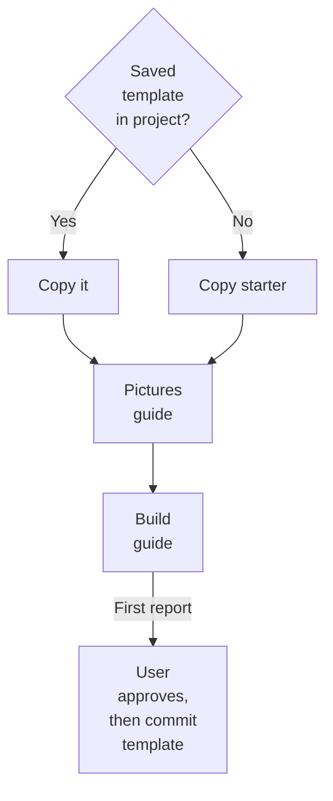

# Client Report

Output = one PDF for a client: what is live, what changed, what is left, who must answer what.

## Routes

## Core rules

- The approved report's HTML + CSS live in the project at `docs/client-report/template.html`, tracked. It holds the look and placeholder text only, never the last report's real text. Copy it for each report and change text only. Never rebuild from Markdown tables or a generic page.
- No codes (A1, C2). Write each item in full.
- Pictures come from the live deployed app, signed in as each role, read only. Test-copy pictures only when the user asks.
- Before sending: the check in [build](references/build.md) passes, then you look at every page image. A page not looked at = a report not sent.
