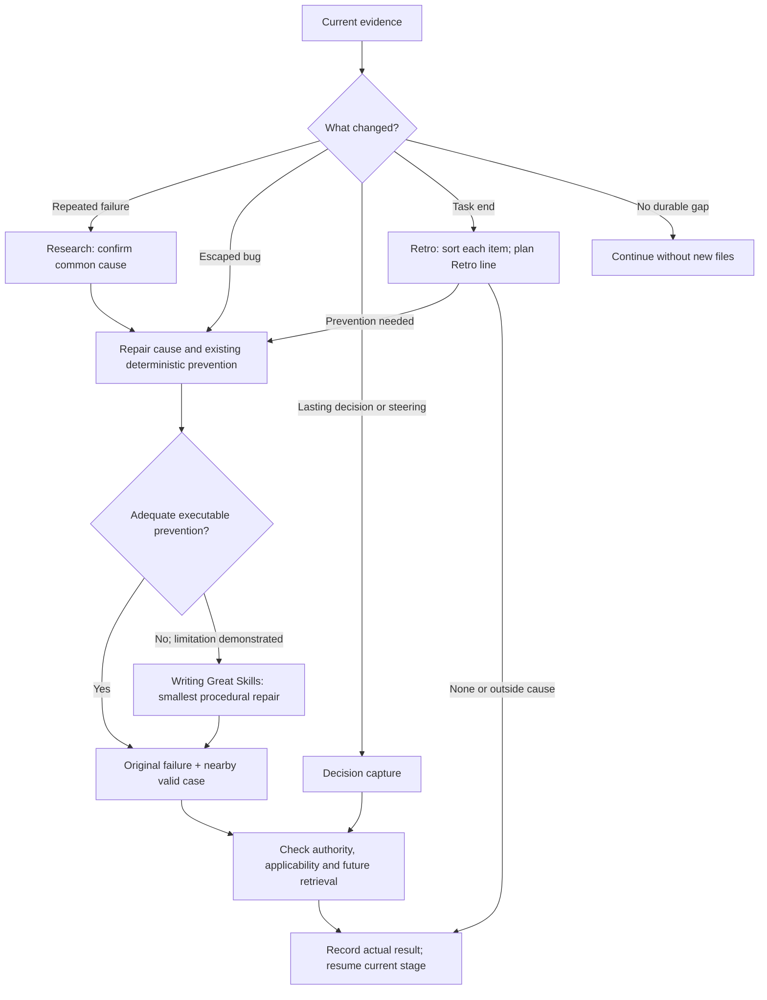

# Hard Eng Learn

- Input = current task + observed attempts/results or explicit decision/steering. Reuse its authorization + participation mode. Hook checkpoints request this judgment; they do not establish recurrence, a cause, or permission to change other projects/global memory.
- Outcome = verified prevention at its narrowest owner, an applicable decision record, or an explicit no-op/blocker. Keep proof + pending work in the same plan; no learning ledger or new task status. Existing tests/docs that already preserve the lesson need no duplicate record.

## Repeated failure → prevention

- Recurrence = as defined in [troubleshooting](../research/references/troubleshooting.md), including its distinguishing evidence before another similar retry. A first confirmed false-pass/protected-boundary defect still warrants immediate repair through its current owner.
- Escaped bug = a defect found on the base branch (user report, revert or failing base check), so it passed every gate on its PR. Learn starts at its first sighting; no repeat is needed. Name the gate that should have caught it (test, type, lint, E2E or ship check). Before the fix, add a case at that gate that fails on the revision with the bug. Fix already merged → run the case on the revision before the fix; state a gap only if that revision cannot run. No gate can catch it → state why in the plan, then apply Skill below.
- Repeat signal = the Stop hook counts each failed check in `.hard-eng/failures.json` (failing lines, numbers masked) and names a second sighting as a repeat; treat it as recurrence evidence, not proof of one cause.
- Same cause = before a fix, search for earlier fixes of this cause and every other place it can occur; fix them together and record them on the plan's `Same cause:` line. `check` fails a Ready plan or a changed Complete plan without it.
- Preference = remove the cause → repair existing invariant/type/test/checker/lint/hook/CI → add the smallest missing deterministic check. Reuse project-native tools. A new script needs repeated fragile logic or a required boundary existing commands cannot check; no checker per incident.
- Proof = the real violating case must fail before repair and pass after it; a nearby valid case must remain valid. Put the check where recurrence would be caught, retain required gates, and name coverage limits. Do not weaken a check or turn a passing command into proof without inspecting its result.
- Skill = last resort for the part executable prevention cannot adequately cover. State that limitation from evidence; reuse/repair an existing skill before adding one. Follow [Writing Great Skills](../writing-great-skills/SKILL.md), including its [repair route](../writing-great-skills/references/repair.md). Canonical location = `.agents/skills/<name>/SKILL.md`; only needed references/scripts belong beside it.
- Attribution = give each tried fix one verdict against the original failure: helped, hurt, no effect or confounded. Confounded = several changes in one run, or one run alone behind the difference. Keep a lesson only from helped fixes; narrow a confounded one to what the evidence shows, or record nothing. Write the trigger as the shape of the situation, not one task's facts.
- Behavioral proof = exercise the original request + nearby valid/non-trigger case. Material trigger, authority, action-order or completion changes need actual agent execution; a wording/metadata check alone is insufficient. Verify the future consumer reaches the rule when relevant. Failed/unknown proof stays unfinished; never promise universal non-recurrence.

## Retro

- When = every task end, before its plan is Complete. Retro line = each item → its row's prevention, named as `path::test`, a rule ID, a step, an issue link, a freshness hold or `None — <reason>`. No item → `None — no failed check or correction`.
- Items = each failed check (Stop hook, local run, pre-push, CI) and each user or review correction in the task, including ones fixed at once.
- Sort each item into every row that fits. In a project that installed Hard Eng, a prevention that would edit a file Hard Eng installed (`.hooks/`, its skills except `trello-coordinator/`) goes to the Hard Eng fault row instead.

| Item | Prevention |
| --- | --- |
| Hard Eng fault: a Hard Eng check, hook, skill or setup was wrong or missing | Tell the user; if approved, file a Hard Eng issue per AGENTS.md's broken Hard Eng rule; still fix the project in this task |
| Ran too late: an existing check first ran at push or CI | The check is a test, analyzer or lint for the touched files (HE Build's focused checks) → fix the worker brief or plan step that skipped it, and name that step. Otherwise → Hard Eng fault row. Never add it to the Stop hook |
| Mechanical: pattern, banned API, file place, size, shape | Deterministic check at its owner: an existing lint or check rule first, else the smallest new one; never one checker per incident |
| Judgement: a defect only a reviewer can find | Add or sharpen one project `REQ-` rule in `docs/requirements.md`, which review applies; name its ID. In Hard Eng itself, the owner is [Code Review's review method](../code-review/references/review.md) |
| Outside cause: outage, upstream release | None + the reason, or a freshness hold on the broken release (the freshness gate's `holds`, in [gates](../he/references/gates.md)) |

- A retro item caused by a second copy of a rule, value or type → merge that copy into its one owner in this change and record it on the plan's `Single source:` line. That line says what to do when the copy cannot merge.

## Apply + continue

- Decisions/steering = [terse ADR capture](references/decisions.md). Matching accepted ADRs are shown by the Stop hook; still read applicable ones before applying a past lesson; current user instructions + verified applicability govern. A code/decision conflict may be a product regression, not stale documentation.
- Scope = authorized local prevention continues through [HE Build](../he-build/SKILL.md) with affected checks; post-ship edits need fresh proof and separately authorized [HE Ship](../he-ship/SKILL.md) delivery. Source-toolkit/global/cross-project changes require their own existing authority.
- Progress = fix risk at the affected stage; learning does not seize unrelated work. No useful durable gap → no new artifact. Missing evidence/authority → retain the concrete next action in the existing plan. A checkpoint, ADR or skill is never a substitute for implementation and proof.
