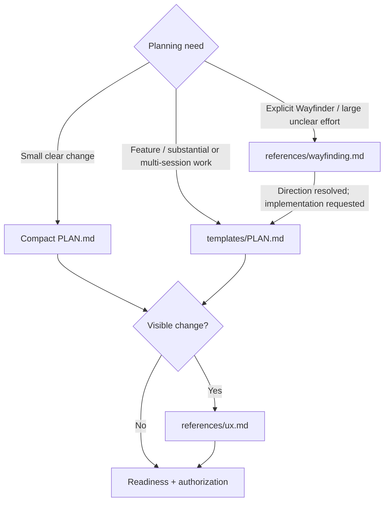

# Hard Eng Plan

- Output = saved PLAN.md: a ready plan (applicable UX reference, baseline evidence, execution recommendation, authorization boundary) or explicit blocking decisions. Planning may also produce research + isolated previews; production code waits for readiness + authorization.
- Context = [Hard Eng workflow](../he/references/workflow.md). Reuse current repository evidence + settled decisions; load [Research](../research/SKILL.md) or [Codebase Design](../codebase-design/SKILL.md) only when needed.

## Routes

Route by intent + actual scope, not keywords. Existing ready plan → continue within its authorization; material change → reopen only the affected decision.

## Participation

Apply the existing [Human-loop or Autonomous mode](../he/references/workflow.md#participation); that owner defines proposal approval, progress and authority boundaries.

## Readiness + authorization

- Ready = outcome + boundaries clear; blocking choices resolved; applicable `ux_reference` shown + direction settled; baseline passed + prerequisite repairs delivered; planned acceptance checks, first step + execution recommendation. Deferred uncertainty stays explicit, inside the authorized scope. When it passes and build is authorized, tell the user: `Ready for build — plan and baseline are verified; implementation is starting.` Proof pending or blocked → no handoff line.
- Authority = the user's instructions under Participation; the plan records their scope, never a self-issued permission. Reuse valid approval or autonomous authorization; else show the completed plan and ask once. Plan-only requests end with the saved PLAN.md, not a chat-only plan.
- Approval covers outcome + boundaries. File/step/test/approach changes → update the same plan and continue. Changed outcome, material scope/risk or an unauthorized consequential action → resolve that boundary only. Plan edits do not expire approval; no hashes, receipts or approval commands.
- Plan checks = pass the [Ready check](../he/references/gates.md#plan-checks) after material choices resolve, before authorized implementation; missing previews keep it Draft. A settled proposal may pass Ready before final combined approval. A structural pass proves no truth, relevance, authority or order: check evidence + N/A reasons against actual work. Host-native read-only controls stay separate.
- Draft handoff = every active Draft declares one in Decisions + authorization: `Handoff: Clarification` = a concrete prerequisite in `Blockers`, may pause before UX/baseline work; `Handoff: Approval` = the user accepts recommendations or picks a prepared proposal, shown with its flow/states first. A proposal review is never clarification. Evidence rules + Stop enforcement = [plan checks](../he/references/gates.md#plan-checks); feedback grants no authority.
- Handoff = ready + authorized + implementation requested → continue through [Hard Eng](../he/SKILL.md). Discovery-only Wayfinder sessions keep their charting/one-ticket stop boundaries.

## Plan + questions

- Tracked evidence = apply [publication privacy](../he-ship/references/checks.md#publication-privacy) before writing plans or attaching evidence.
- Small = `check` decides by script from the whole branch against its merge base (README, Plan); small needs no plan, but a written plan is still validated. Never call a change small yourself.
- Both sizes = [PLAN.md](templates/PLAN.md); one plan per effort at root or `features/<slug>/PLAN.md` (filename case-insensitive); reuse it. Brief fields + `behavior → proof` checkboxes, no narrative; link detailed evidence. Fill every section; `N/A — reason` must follow repository facts. Unavailable tools, failed checks + missing proof are blockers, never N/A.
- Questions = check repository facts first; ask only user choices that change outcome, UX, scope or material risk. Prerequisites first; batch independent questions, each with a recommendation + consequences. Never answer for the user or read silence as approval. Clear request → no interview.
- Setup/adoption/update = [integration setup](../he/references/integrations.md) for intended services, hosting, existing choices + real host readiness; greenfield imports cannot show future integrations. New Flutter app = Riverpod per [Building Flutter Apps](../building-flutter-apps/SKILL.md).
- Proof = map each material requested behavior + preserved constraint to a check + observable result in Acceptance + steps; mark exclusions or blockers. `E2E:` is separate from `ux_reference`: unchanged looks do not waive an interaction journey. Use [test design](../he/references/testing.md) + [E2E](../e2e/SKILL.md); checkboxes name tests per the template; a user-journey checkbox names its E2E test; outside service → fake from its real responses, never call it. Ready needs planned proof + actual baseline/UX evidence; Complete needs actual results. Deployment-only E2E needs Deploy + a configured verifier; Merge closes before runtime proof.
- Delivery = acceptance stays local; Verification keeps the authorized destination + pending remote proof for [HE Ship](../he-ship/SKILL.md). Local Complete comes before shipping. Before UI work, keep the real baseline for the PR comparison, even after a mock; prepare task isolation.
- Flow gaps = for material state, permission, recovery or cross-system behavior, inspect entry points, branches + success/failure/recovery outcomes before Ready. Reuse existing handlers; settle consequential unspecified behavior through Questions and carry the scenarios into acceptance. Settled low-risk work needs no walkthrough.
- Uncertainty = consequential unverified technical assumption → record evidence, the cheapest discriminating check + what changes if false. Resolve planning-owned facts by research or an authorized isolated prototype; keep build-dependent details explicit. Unresolved product choices stay blockers; low-impact details do not.

## Before handoff

- Baseline (Start Gate B) = run the [Draft check](../he/references/gates.md#plan-checks) on the starting code after planning/UX, before approval or implementation; keep previews out of it. Reuse only matching code/config/environment evidence; the check reuses the branch point's passed CI for unchanged packages. Record command + actual result. Failure → [baseline repair](../he/references/gates.md#baseline-repair); no waiver.
- Sequencing = each substantial slice delivers observable behavior + its journey's E2E test; an early thin slice tests the main uncertainty, never around it. Parallel work needs agreed interfaces + a named integration check.
- Execution recommendation = smallest suitable arrangement: one builder for contained work; parallel only for independent work; a fresh verifier for substantial work. Name roles, dependencies and actually available models/tools; never invent models, force four agents or dispatch while planning. Respect delegation limits.
