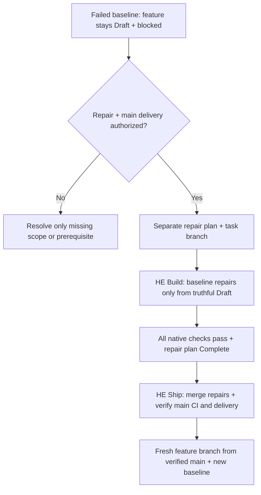

# Adapt + repair checks

Apply when adapting or repairing project checks; use native diagnostics for enforced requirements.

Ready/Complete plans need an explicit `E2E:` disposition. When reopening or validating an older plan, derive it from that plan's recorded runtime evidence or a concrete inapplicability reason; missing evidence remains pending. Do not relabel historical tests as fresh execution or turn local proof into remote delivery.

| Agent decision          | Required proof                                                                                                                                                                                                                                                                                                                                                                                                                                                                                                                                                                                                                                                                                                                                                                                                                                                                                                                                                                                                                                                                                                                                                                                                                                                                                                                                                                                                                                                                                                                                                                                                                                                                                                                                                                                                                                                                                                                                                                                              |
| ----------------------- | ----------------------------------------------------------------------------------------------------------------------------------------------------------------------------------------------------------------------------------------------------------------------------------------------------------------------------------------------------------------------------------------------------------------------------------------------------------------------------------------------------------------------------------------------------------------------------------------------------------------------------------------------------------------------------------------------------------------------------------------------------------------------------------------------------------------------------------------------------------------------------------------------------------------------------------------------------------------------------------------------------------------------------------------------------------------------------------------------------------------------------------------------------------------------------------------------------------------------------------------------------------------------------------------------------------------------------------------------------------------------------------------------------------------------------------------------------------------------------------------------------------------------------------------------------------------------------------------------------------------------------------------------------------------------------------------------------------------------------------------------------------------------------------------------------------------------------------------------------------------------------------------------------------------------------------------------------------------------------------------------------------- |
| Package/source coverage | Match actual production owners, nested packages + native workspaces. Review scan roots, generated/vendor attributes, ignored files and dynamic entry points; a clean report cannot prove omitted code was examined.                                                                                                                                                                                                                                                                                                                                                                                                                                                                                                                                                                                                                                                                                                                                                                                                                                                                                                                                                                                                                                                                                                                                                                                                                                                                                                                                                                                                                                                                                                                                                                                                                                                                                                                                                                                         |
| Affected selection      | `depends_on` = reviewed direct package-impact edges from native manifests, workspace/service setup and root lockfile/tool providers; traversal includes transitive dependents. Every package in a multi-package repository requires that review; missing mappings fail verification, and `[]` means reviewed independence. A cycle is allowed (Fallow coverage reuse needs one), but a package outside a cycle may not depend on a member, because every change in the cycle would select it; name the files it reads in `impact_inputs` instead. Initial setup leaves mappings for review. `impact_inputs` adds repository-relative file/directory inputs read by a package's checks, including cross-language contracts and documentation used as data; match exact paths or descendants, including deletions. Plans, Markdown (except below the root of a JavaScript package, which a site may build from), `AGENTS.md`/`CLAUDE.md` and `.agents/` outside `he/` run only the secret scan, and other workflow YAML files under `.github/workflows/` add workflow linting, when no declared input consumes them; other `.github/` files keep their owner's checks. `.hooks/`, `.agents/skills/he/`, `hard-eng.gates.json` and `.github/` files whose base or current version runs `hard-eng.py` select every package unless a verified update installed them; the check prints the file that did. Review imported schemas, generated sources and shared configuration before narrowing scope; selected packages still run their full suites and coverage. Pre-push checks only the packages that own changed files; CI adds their dependents. Before push, a JavaScript test gate whose script runs `bun test` (without a `bunfig.toml` coverage threshold), Vitest or Jest runs only the tests related to the change, without the coverage threshold; CI runs the full suite with coverage. Python and Dart tests, chained scripts and packages whose coverage a `bun run` Fallow gate reuses stay full. |
| CI ownership            | Inspect existing jobs before assigning Hard Eng work. Each required assertion has one job/owner; compare arguments, reports and thresholds before removing duplicates. Keep local native checks; integrate missing CI assertions into existing jobs and name their required results in `shipping.checks`. Setup preserves existing workflows and leaves adaptation pending; it generates a new workflow only with a project shipping policy.                                                                                                                                                                                                                                                                                                                                                                                                                                                                                                                                                                                                                                                                                                                                                                                                                                                                                                                                                                                                                                                                                                                                                                                                                                                                                                                                                                                                                                                                                                                                                                |
| Import boundaries       | Derive public/private interfaces + allowed dependencies from actual architecture. Prove allowed → pass, forbidden → fail, restored → pass, including relevant aliases, exports + test imports. Do not invent boundaries to satisfy a gate.                                                                                                                                                                                                                                                                                                                                                                                                                                                                                                                                                                                                                                                                                                                                                                                                                                                                                                                                                                                                                                                                                                                                                                                                                                                                                                                                                                                                                                                                                                                                                                                                                                                                                                                                                                  |
| Performance             | Choose representative workloads/environment + justified latency, memory, frame or operation budgets. Intentionally exceed each budget to prove failure. Flutter rendering needs profile-mode device measurements; debug unit tests are insufficient. See [Efficiency](efficiency.md) for bulk/async cases.                                                                                                                                                                                                                                                                                                                                                                                                                                                                                                                                                                                                                                                                                                                                                                                                                                                                                                                                                                                                                                                                                                                                                                                                                                                                                                                                                                                                                                                                                                                                                                                                                                                                                                  |
| Security + dependencies | Review actual trust boundaries, native exclusions, extractor coverage + selected lockfiles/images. Confirm the scanned image is the intended build; scanner success does not establish exploitability or complete coverage. With a resolvable `--base`, the `secrets-history` gate's `--log-opts=--all` scans only `base..HEAD`, because earlier commits were scanned when they entered; without one, it scans branches, remotes, tags + `HEAD`, not private tool refs.                                                                                                                                                                                                                                                                                                                                                                                                                                                                                                                                                                                                                                                                                                                                                                                                                                                                                                                                                                                                                                                                                                                                                                                                                                                                                                                                                                                                                                                                                                                                     |
| Untrusted input (JS/TS) | Setup ships `.hooks/untrusted-input.d.ts`, adds it to each package `tsconfig.json` and adds `.hooks/**` to the root Fallow `ignorePatterns`, so `Response`/`Request` `.json()` and `JSON.parse` return `unknown` and `Array.isArray`, `Object.values` and `Object.entries` keep `unknown` elements instead of `any`; `types` fails on unvalidated use and when the declaration is missing. `typing-style` runs Biome `noUnsafeTypeAssertion`: every `as T` except `as const` fails, tests and UI included; the runner fails JavaScript `/** @type {T} */ (value)` casts the same way. Fix by parsing with a Zod schema at the boundary (the project's existing validator or a type guard also passes) and return the parsed type; never cast, and never route data through `any` to escape the check.                                                                                                                                                                                                                                                                                                                                                                                                                                                                                                                                                                                                                                                                                                                                                                                                                                                                                                                                                                                                                                                                                                                                                                                                       |
| Missing inputs          | Repair missing/stale coverage, reports, generated sources or comparison refs at their producer/selection owner. Preserve the required metric, threshold and scope; disabling the metric or asserting the disabled configuration in a test does not repair the input. Unavailable proof remains a failed/blocked check.                                                                                                                                                                                                                                                                                                                                                                                                                                                                                                                                                                                                                                                                                                                                                                                                                                                                                                                                                                                                                                                                                                                                                                                                                                                                                                                                                                                                                                                                                                                                                                                                                                                                                      |
| Exceptions              | Only proven false positives or intentional supported patterns; narrow native exception + adjacent reason/evidence. Keep the rule active elsewhere. No baseline, tolerance, ignore list, inline disable, raised threshold or hidden warning for an actual finding: repair it in code per the AGENTS.md Verification rule. The one record of old findings is install-time debt: [HE-DEBT-SHRINK-ONLY](requirements.md#he-debt-shrink-only).                                                                                                                                                                                                                                                                                                                                                                                                                                                                                                                                                                                                                                                                                                                                                                                                                                                                                                                                                                                                                                                                                                                                                                                                                                                                                                                                                                                                                                                                                                                                                                   |
| Parallelism             | Opt in only independent commands with distinct outputs; up to one runs per CPU, so account for child workers, memory + connections. Parallel secret, vulnerability, security, workflow and shell scans start after dependency setup and the last file-producing serial gate, beside serial suites; performance suites and JavaScript tests in the same folder still wait for them. Builds, generators and report cleaners may need ordering. Setup runs a generated pytest gate with `pytest-xdist` and `-n auto`, and upgrades an older serial one on update. A suite that shares a database, port or fixed file across tests fails under it: isolate that state per worker, or keep the suite serial by setting `-n 0` in the gate command, which setup preserves.                                                                                                                                                                                                                                                                                                                                                                                                                                                                                                                                                                                                                                                                                                                                                                                                                                                                                                                                                                                                                                                                                                                                                                                                                                        |

When no meaningful performance workload and justified budget exist, review the package's responsibilities and actual consumers before recording a nonblank `performance_exception` string in that package's gate group. Include the reason, inspected evidence and changes that require revisiting it. Package size or language alone is insufficient; missing tests or an inconvenient failing budget is not an exception. Remove only the unused template performance placeholder after review. Setup preserves the declaration and omitted check; every configured performance suite still runs with serial execution and native report validation. Unit tests, coverage and all other strict checks remain mandatory. The parser validates the declaration's shape, not the review's correctness.

CI adaptation starts at setup and is revisited whenever Hard Eng is adopted or updated or CI changes; it is not a second check runner or receipt store. Reuse native job dependencies and failure propagation; required checks must report for affected and unaffected changes. A deploy job can `needs:` a job that `uses: ./.github/workflows/hard-eng.yml` with the `base_sha` input; the called check reports as `<caller job> / hard-eng`, which `shipping.checks` must name. Push/PR execution requires a nonblank `--base`; use `github.event.pull_request.base.sha || github.event.before`, or the reusable workflow's `base_sha` input. Local and manual full runs may omit it. Review package impact before verification; an unavailable comparison ref or uncertain changed-file impact still selects full scope. Provision only the selected owners' tools, measure a cache before keeping it, and measure both critical-path time and runner minutes. Do not widen timeouts to conceal duplication. A build/performance/browser prerequisite remains required when its consumer moves jobs.

Measure setup, checks, waiting and deployment separately. Replace a runner polling another workflow with native `needs`/reusable-workflow ordering, then remove duplicate triggers. Install Hard Eng's tools without an Actions cache: on measured standard runners a restore took as long as the download, and saving a changed key cost more. Use the same package-manager store before dependency installation. Resolve each native workspace's locked dependencies once per job, before its consumers; remove duplicate workflow/wrapper installs only when the retained owner supplies the same dependencies and lifecycle scripts. Keep code generation once before its checks, retaining output-drift assertions; use Flutter's `--no-pub` only after the locked dependency gate succeeds. Remove repeated tests/scans only after comparing scope, tool versions, arguments and report thresholds. Dart Decimate's unfiltered strict `check` already includes boundary findings; its `--boundary-violations` option filters output and must not be added to the combined dead-code/duplicate gate.

Measure before and after each CI change: `python3 .hooks/hard-eng.py ci-usage [--repo owner/name] [--days 14]` reports billed minutes by workflow, event and job, whole-minute rounding, cancelled and failed minutes, jobs that never got a runner, and jobs run on both push and pull_request. Public repositories' standard runners are free, so optimise their wall-clock time instead. A push to the shipping base reuses the merged PR's required checks when the pushed commit holds exactly the tree that PR passed; callers of the reusable workflow keep `contents: read` and `checks: read` so the lookup works, and any failed lookup runs the full check. Fix measured waste at its owner: fold jobs whose setup outweighs their work into a neighbour, replace polling with `needs`, cancel superseded runs with `concurrency`, bound each job with a measured `timeout-minutes`, keep macOS (10x) and Windows (2x) runners for platform code, and treat jobs that never got a runner as a runner-configuration fault.

`shipping.ci_seconds` bounds each named check's reported execution time. A three-second aggregate does not measure its upstream jobs: retain meaningful worker checks in the policy and measured native workflow/job timeouts. Report end-to-end CI elapsed time separately; do not claim a whole-pipeline budget from the aggregate's duration. Existing monoliths require a deliberate assertion-by-assertion migration before removing their product triggers; setup never deletes them automatically.

Basic mode (no supported manifest) has no packages: `packages` is empty and `shared` holds secrets-files, secrets-history, security (Semgrep `p/default`, excluding the installed `.agents` and `.hooks`) and, only when a lockfile OSV reads exists, vulnerabilities. Add project-owned checks as gates; CI installs only the bootstrap tools.

Use existing [Python](../templates/hard-eng.python.json), [JavaScript](../templates/hard-eng.javascript.json), [Dart/Flutter](../templates/hard-eng.dart.json) or [Swift](../templates/hard-eng.swift.json) templates when adapting a new package. Setup adds a Swift group per Flutter `ios/` or `macos/` folder with an Xcode project and Swift beyond Flutter's unchanged starter files (compared by text with Flutter's templates), and removes the group when only starter files remain; unchanged starter files are not production files; its tests need macOS, and CI picks the runner from `impact`'s `runner=` line. Measured on a fresh Flutter app on a loaded Mac: iOS `tests` 231 s on the first run and 45-67 s after, macOS `tests` 18 s, every other Swift gate under 5 s; set `shipping.ci_seconds` from your own macOS run, which also downloads Flutter and the iOS engine. Do not copy a template over project-specific contracts.

## Adopting existing checks

At setup, list the project's existing checks (pre-push/pre-commit hook commands, lefthook, pre-commit or husky configs, CI check jobs) beside Hard Eng's gates and show the user a comparison table. A project pre-push hook is kept and runs first; Hard Eng's checks run only if it passes.
- Hard Eng's gate does the same or better → use Hard Eng's.
- Project check does something Hard Eng lacks → keep it as a gate in `hard-eng.gates.json`, so the single pre-push runs everything, and file a gap issue: `python3 .hooks/hard-eng.py gap-issue "<missing check, generic>"`. File without asking. Never include project names, code, paths or data; the command refuses paths, file names, URLs, emails and long text.
- Unsure → keep both.

Existing code that fails Hard Eng's gates at install: run `python3 .hooks/hard-eng.py adopt` before the install reaches the default branch, and commit `hard-eng.debt.json` with it ([HE-DEBT-SHRINK-ONLY](requirements.md#he-debt-shrink-only)). Gates that adopt refuses follow [baseline repair](#baseline-repair).

Remove nothing project-owned until the user approves the table. After approval, a fully absorbed original hook can be dropped from the chain by deleting its `.project` copy and rerunning setup.

## Plan checks

Load for planning-stage checks or plan validation failures. Use [HE Plan](../../he-plan/SKILL.md) for readiness + authorization; [PLAN.md](../../he-plan/templates/PLAN.md) owns required fields.

| Command                                                  | Required declaration                                                                                                                                                             |
| -------------------------------------------------------- | -------------------------------------------------------------------------------------------------------------------------------------------------------------------------------- |
| `python3 .hooks/hard-eng.py check --plan-stage Draft`    | Filled plan; permits pending baseline/intermediate verification.                                                                                                                 |
| `python3 .hooks/hard-eng.py check --plan-stage Ready`    | Ready or Complete; baseline Passed with evidence; UX Passed with a rendered Mock/Existing/New proposal image or reasoned N/A; explicit E2E disposition; no declared blockers.    |
| `python3 .hooks/hard-eng.py check --plan-stage Complete` | Complete; above requirements + implementation evidence, no unchecked requirements, and no pending local E2E. Deployment-only E2E requires Deploy and configured delivery checks. |

Each command also runs native project checks, [HE-COMMENT-LINES](requirements.md#he-comment-lines), [HE-NO-SWITCH-OFF](requirements.md#he-no-switch-off) and the [requirement registry](requirements.md#he-requirement-registry) check (`--quick` runs them too), except when `--base` shows a merged PR already passed the same tree or the change is a verified scaffold-only update. Without `--base`, a plan-stage command compares with the commit the branch left on the `shipping.base` remote branch when that commit's required CI checks passed, so only changed packages and their dependents run; otherwise every package runs. `check --quick`, used only by the Stop hook, runs just the gates whose role is `format`, `lint`, `format-lint`, `types`, `annotations`, `typing-style`, `imports`, `focused-tests` or `secrets-files`, so no test suites, over the files changed since the later of the session's start and the last commit already on any remote branch (pushed commits passed pre-push); plan validation is unchanged. Ordinary `check` (including pre-push/CI) runs every gate and requires Complete for non-Markdown changes; Markdown-only planning can stop at Draft/Ready. Stop checks at Ready while every unfinished applicable plan is Ready with Verification Pending (a build in progress), unless a line of the turn opens with the HE Build handoff `Ready for ship —`. Changed root/feature plans take precedence; otherwise active plans apply. An unchanged historical Complete plan cannot cover new work relative to a known base. Missing bases fail plan validation; a new branch's zero base, or a rewritten branch whose old remote tip is not an ancestor (such as a reused `hard-eng/update`), compares with its merge base on the `shipping.base` remote branch, and an unborn repository or missing remote branch uses Git's empty tree (the whole initial snapshot). Unchanged Complete plans keep their recorded rules: a missing `E2E:` field fails only once the plan is edited. Unchanged repositories can still be audited without inventing a task plan. Without an applicable plan, `check` prints `Size: small` and waives only the plan requirement when the whole branch change is documentation or small (README, Plan); otherwise it prints `Size: big, because …` and fails.

Draft Stop requires an explicit `Handoff: Clarification` with a real prerequisite question, or `Handoff: Approval` with baseline, UX and E2E planning evidence. Missing/invalid declarations and incomplete approval evidence block; a clarification does not waive another plan's requirements. This is a declared handoff check, not a trusted approval record, proof of the conversation's meaning or host compliance. See [HE Plan](../../he-plan/SKILL.md#readiness--authorization).

Plan-only edits after a matching passed baseline → use the same stage command with `--base HEAD` to validate the plan and affected checks. The baseline must cover the current code/configuration/environment; `--base HEAD` cannot substitute for that proof. Uncommitted code/config changes remain in the comparison, unknown impact retains full scope, and required pre-push/CI checks still run. Do not repeat the whole application suite solely for plan wording or a Draft-to-Ready declaration change.

The check validates structure + declarations, not evidence truth, approval, relevance or delivery chronology. A passing Draft/Ready run is not implementation completion. Baseline Exception is rejected. If the Ready or Complete command fails, return the same plan to Draft with the actual blocker; do not replace failure with N/A or leave a false Ready/Complete claim. Starting failures follow [baseline repair](#baseline-repair); build regressions stay in their current effort. Neither route may weaken checks to bypass actual findings.

## Baseline repair

- Repair scope = all actual enforced baseline failures, including pre-existing debt and findings unrelated to the task or surfaced by a newer tool release; age, effort or relevance is not an exemption. Correct proven false positives only under the existing [native exception rule](#adapt--repair-checks). Reuse valid user authorization; otherwise ask for the missing repair/delivery scope.
- Repair is the sole failed-baseline implementation route: record failures, bounded repair steps + intended proof before edits. Preserve the original failed evidence; after repair, record the passing rerun as current baseline and complete normal build checks. Never declare Ready while checks fail.
- Feature resumes only after the repair revision is on the intended main branch and required CI/delivery checks pass. An open PR or local pass is insufficient. Keep repair and feature plans/diffs separate; apply the feature's original authorization and readiness rules after updating its baseline.
