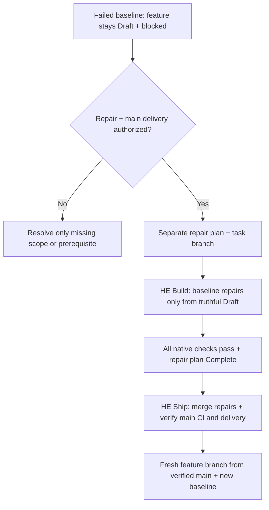

# Plan stage checks

## Plan checks

Load for planning-stage checks or plan validation failures. Use [HE Plan](../../he-plan/SKILL.md) for readiness + authorization; [PLAN.md](../../he-plan/templates/PLAN.md) owns required fields.

Ready/Complete plans need an explicit `E2E:` disposition. When reopening or validating an older plan, derive it from that plan's recorded runtime evidence or a concrete inapplicability reason; missing evidence remains pending. Do not relabel historical tests as fresh execution or turn local proof into remote delivery.

| Command                                                  | Required declaration                                                                                                                                                             |
| -------------------------------------------------------- | -------------------------------------------------------------------------------------------------------------------------------------------------------------------------------- |
| `python3 .hooks/hard-eng.py check --plan-stage Draft`    | Filled plan; permits pending baseline/intermediate verification.                                                                                                                 |
| `python3 .hooks/hard-eng.py check --plan-stage Ready`    | Ready or Complete; baseline Passed with evidence; UX Passed with a rendered Existing/New/Mock proposal image or reasoned N/A; explicit E2E disposition; no declared blockers.    |
| `python3 .hooks/hard-eng.py check --plan-stage Complete` | Complete; above requirements + implementation evidence, no unchecked requirements, and no pending local E2E. Deployment-only E2E requires Deploy and configured delivery checks. |

Each command also runs native project checks, [HE-COMMENT-LINES](requirements.md#he-comment-lines), [HE-NO-SWITCH-OFF](requirements.md#he-no-switch-off), [HE-UI-SOURCE](requirements.md#he-ui-source) and the [requirement registry](requirements.md#he-requirement-registry) check (`--quick` runs them too), except in CI when the same tree already passed the required checks (a push that lands one merged PR that passed, or a release PR from the `shipping.base` branch whose head commit passed), or when the change is a verified scaffold-only update. Without `--base`, a plan-stage command compares with the commit the branch left on the `shipping.base` remote branch when that commit's required CI checks passed, so only changed packages and their dependents run; otherwise every package runs. `check --quick`, used only by the Stop hook, runs just the gates whose role is `format`, `lint`, `format-lint`, `types`, `annotations`, `typing-style`, `imports`, `focused-tests` or `secrets-files`, so no test suites, over the files changed since the later of the session's start and the last commit already on any remote branch (pushed commits passed pre-push); plan validation is unchanged. Ordinary `check` (including pre-push/CI) runs every gate and requires Complete for non-Markdown changes; Markdown-only planning can stop at Draft/Ready. Stop checks at Ready while every unfinished applicable plan is Ready with Verification Pending (a build in progress), unless a line of the turn opens with the HE Build handoff `Ready for ship —`. Changed root/feature plans take precedence; otherwise active plans apply. An unchanged historical Complete plan cannot cover new work relative to a known base. Missing bases fail plan validation; a new branch's zero base, or a rewritten branch whose old remote tip is not an ancestor (such as a reused `hard-eng/update`), compares with its merge base on the `shipping.base` remote branch, and an unborn repository or missing remote branch uses Git's empty tree (the whole initial snapshot; HE-UI-SOURCE judges nothing there). Unchanged Complete plans keep their recorded rules: a missing `E2E:` field fails only once the plan is edited. Unchanged repositories can still be audited without inventing a task plan. Without an applicable plan, `check` prints `Size: small` and waives only the plan requirement when the whole branch change is documentation or small (README, Plan); otherwise it prints `Size: big, because …` and fails.

Draft Stop requires an explicit `Handoff: Clarification` with a real prerequisite question, or `Handoff: Approval` with baseline, UX and E2E planning evidence. Missing/invalid declarations and incomplete approval evidence block; a clarification does not waive another plan's requirements. This is a declared handoff check, not a trusted approval record, proof of the conversation's meaning or host compliance. See [HE Plan](../../he-plan/SKILL.md#readiness--authorization).

Plan-only edits after a matching passed baseline → use the same stage command with `--base HEAD` to validate the plan and affected checks. The baseline must cover the current code/configuration/environment; `--base HEAD` cannot substitute for that proof. Uncommitted code/config changes remain in the comparison, unknown impact retains full scope, and required pre-push/CI checks still run. Do not repeat the whole application suite solely for plan wording or a Draft-to-Ready declaration change.

The check validates structure + declarations, not evidence truth, approval, relevance or delivery chronology. A passing Draft/Ready run is not implementation completion. Baseline Exception is rejected. If the Ready or Complete command fails, return the same plan to Draft with the actual blocker; do not replace failure with N/A or leave a false Ready/Complete claim. Starting failures follow [baseline repair](#baseline-repair); build regressions stay in their current effort. Neither route may weaken checks to bypass actual findings.

## Baseline repair

- Repair scope = all actual enforced baseline failures, including pre-existing debt and findings unrelated to the task or surfaced by a newer tool release; age, effort or relevance is not an exemption. Correct proven false positives only under the existing [native exception rule](gates.md#adapt--repair-checks). Reuse valid user authorization; otherwise ask for the missing repair/delivery scope.
- Repair is the sole failed-baseline implementation route: record failures, bounded repair steps + intended proof before edits. Preserve the original failed evidence; after repair, record the passing rerun as current baseline and complete normal build checks. Never declare Ready while checks fail.
- Feature resumes only after the repair revision is on the intended main branch and required CI/delivery checks pass. An open PR or local pass is insufficient. Keep repair and feature plans/diffs separate; apply the feature's original authorization and readiness rules after updating its baseline.
